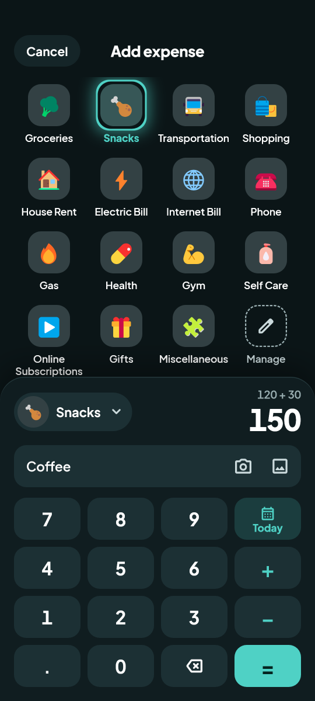
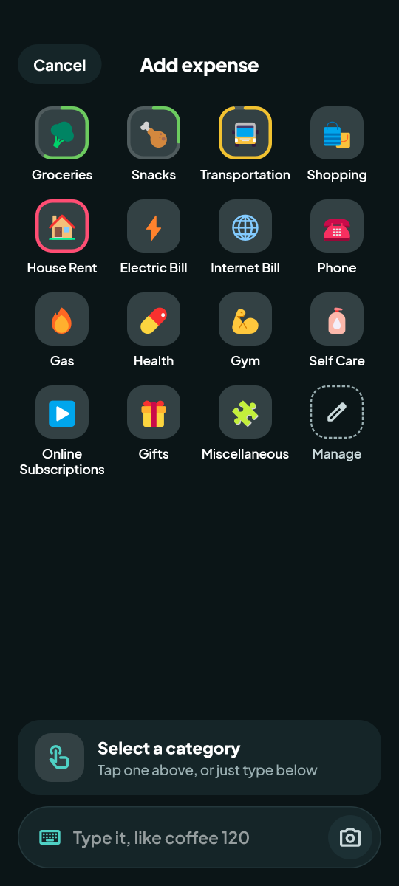
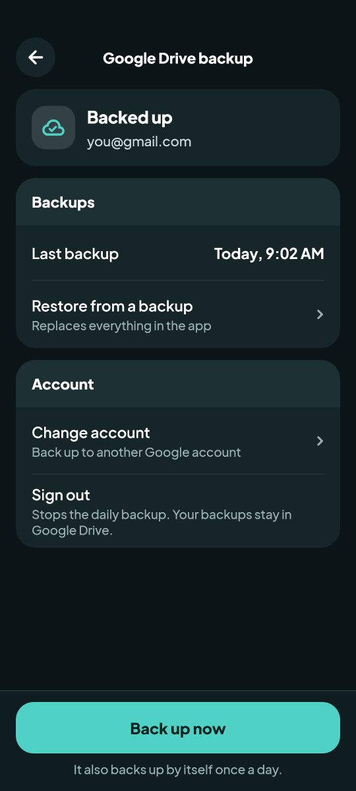

# 💸 Spill the Bills

**A simple, private expense tracker for Android.**

Write down what you spend. See where your money goes. Everything stays on your own phone, with an optional backup to your own Google Drive. No sign-up, no ads.

<p align="center">
  
  
  
  
</p>
<p align="center">
  
  
  
  
</p>
<p align="center">
  
  
</p>

## ✨ What you can do

- ⚡ **Add an expense in seconds.** Pick a category, type the amount on the keypad, done. The keypad has a built-in calculator, so you can type `120 + 30`.
- ⌨️ **Or just type a sentence.** Write something like `coffee 120` or `250 taxi`. The app finds the amount, the title and the category. If it meets a new word, you pick the category once, and it remembers next time.
- 🎨 **Colourful emoji categories.** Add your own, change them, and put them in the order you like.
- 📅 **Calendar.** See the whole month with the total for each day. Tap a day to see what you spent.
- 📊 **Charts.** Look at a week, a month, a year, or any dates you choose. See your spending by category, your biggest days, or how it changes over time.
- 🧾 **Reports.** See your all-time total, your average month, and a table of every month. Pick a year to see it at a glance.
- 🎯 **Monthly budgets.** Give a category a budget, like Snacks 5,000 a month. When you add an expense, a ring around each category shows how much is used: green, then yellow from 90%, then red once you go over. A short message tells you when you pass 90% and when you go over, and by how much.
- 👛 **Pockets.** Keep money apart, for example Home, Trip and Work. Each pocket has its own expenses. You can move an expense to another pocket later.
- 📷 **Receipt photos.** Add a photo to an expense, from the camera or from your gallery.
- 📤 **Export and import.** Save your expenses as an Excel or CSV file. Bring expenses in from a CSV, Excel or JSON file.
- 🎭 **Three colour themes,** each in dark and light. In Settings, choose Dark, Light or System (System follows your phone).
- 🔠 **Text size you can change,** so it is easy to read.
- 🙈 **Hide the total.** Turn on Privacy hide to cover the big number until you tap the eye.
- 🔢 **Numbers your way.** Choose how numbers look, like 1,234,567.89, 12,34,567.89 or 1234567.89, with or without decimals.
- ☁️ **Google Drive backup.** Sign in once and the app backs up everything to your own Google Drive every day, photos included. Restore it on any phone.

## 🔒 Private by design

- 🚫 **No sign-up.** There is no account to make. Google sign-in is only for the backup, and only if you turn it on.
- 🧼 **No ads and no tracking.**
- 📴 **Works offline.** The only thing that ever goes online is the Google Drive backup, if you turn it on.
- 🔐 **Your backups are yours.** They go to your own Google Drive. The app can only see the backup files it made, nothing else in your Drive, and nobody else gets a copy.

## 📲 How to install

You do not need the Play Store. You download one file and open it.

1. 🌐 On your phone, open the **[Releases page](https://github.com/shoeb-gg/Expense-Tracker/releases/latest)**.
2. ⬇️ Under **Assets**, tap `Spill-the-Bills-<version>.apk` to download it. It is about 25 MB and works on most phones. (`<version>` is a number like 1.0.0.)
3. 🔁 If your phone says the app can't be installed, download `Spill-the-Bills-<version>-all-phones.apk` instead. It is about 60 MB and works on every Android phone.
4. 📂 Open the file you downloaded. Your phone may find it in the notification, in your browser's downloads, or in the Files app.
5. ✅ When Android asks, allow installs from this source (this is usually your browser or Files app). Then tap **Install**.
6. 🎉 Open **Spill the Bills** and add your first expense.

**⚠️ Android may show a warning.** That is normal. It happens because the app does not come from the Play Store. The app is safe to install if you got it from the Releases page above.

**📋 What you need:** a phone with **Android 7 or newer**.

## 🔄 Updating

Download the newer file from the [Releases page](https://github.com/shoeb-gg/Expense-Tracker/releases/latest) and install it over the old app. Your expenses stay. Either file works for updating.

## 💾 Keeping your data safe

Your expenses live on your phone. Turn on the backup so you don't lose them with the phone.

- ☁️ **Turn on Google Drive backup.** Go to **Settings → Google Drive backup** and tap **Sign in with Google**. Any Google account works.
- 🕒 **It runs by itself.** Once a day, when you open the app. You can also tap **Back up now**. The newest 10 backups are kept.
- 📁 **Where it goes.** A folder called **Spill the Bills backups** in your Google Drive. It uses your Drive's free space; photos make backups bigger.
- 📲 **On a new phone,** install the app, go to **Settings → Google Drive backup**, sign in with the same account and pick a backup. Restoring replaces everything in the app.
- 📤 **Export still works too.** **Settings → Export** saves your expenses as an Excel or CSV file, and **Settings → Import** brings them back.
- ⚠️ **Uninstalling the app deletes its data on the phone.** Your Drive backups stay.

## ❓ Questions

**💰 Is it free?**
Yes. There are no ads and nothing to buy.

**📴 Does it need the internet?**
No. It works fully offline. Only the optional Google Drive backup goes online.

**🍎 Is there an iPhone version?**
Not yet. It is Android only for now.

**💱 Why are there no currency symbols?**
On purpose. The app shows plain numbers, so you can use it with any money.

## 🛠️ For developers

Spill the Bills is a [Flutter](https://flutter.dev) app (Flutter 3.38, Dart 3.10). The code is in the [`app`](app) folder. The data is kept in a local SQLite database. There is more about the design choices in [`ARCHITECTURE.md`](ARCHITECTURE.md).

```bash
cd app
flutter pub get
flutter run          # run on a phone or emulator
flutter test         # run all the tests
```

**Release builds** (both APKs, in `app/build/release/`):

```bash
cd app
pwsh tool/release.ps1
```

This needs the `android/key.properties` file, which is kept out of git. Without it, release builds are signed with the debug key, and such a build can't update an app that was signed with the real key.

**Google Drive backup** signs in through the `spill-the-bills` Google Cloud project. Its Android OAuth client is tied to the package name and the permanent key's SHA-1, so sign-in only works in builds signed with that key. A fork needs its own Google Cloud project: enable the Drive API, add the `drive.file` scope, create an Android client (package name + your key's SHA-1) and a Web client, and put the Web client ID in `lib/backup/drive_auth.dart`.

**Check a download is genuine.** Releases are signed with one permanent key. The SHA-256 fingerprint of its certificate is:

```
34:F3:F8:0F:26:D8:43:AC:40:94:F4:C8:8C:E7:F3:F0:66:E3:D8:A4:94:70:5D:9B:33:72:DE:4C:78:71:4D:FA
```

To see the fingerprint of a downloaded file, run `apksigner verify --print-certs <file>.apk` (from the Android SDK build-tools) and compare the `certificate SHA-256 digest` line. It is shown without the colons.

**Update the README pictures.** The screenshots in `docs/screenshots/` come from a test. Run it from the `app` folder:

```bash
flutter test --dart-define=README_SHOTS=true test/shots/readme_shots_test.dart
```
